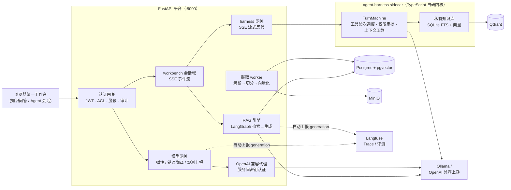

# Agent Platform — 企业级 LLM Agent 平台

> 统一工作台一个入口承载**知识问答（RAG）**与**代码工程师 Agent** 双引擎，认证、知识库、模型网关、全链路观测开箱即用，Docker Compose 一键私有化部署。

## 定位

这是一个面向企业内部场景的 LLM Agent 平台：聊天框是唯一入口，背后是两条完整引擎——基于 LangGraph + pgvector 的检索问答，与基于自研 TypeScript 内核的代码工程师 Agent（工具调度 / 权限审批 / 上下文压缩）。

平台侧把 Agent 应用的「工程件」全部做齐：模型网关统一出口与弹性降级、OpenAI 兼容代理统一多服务模型调用、PII 脱敏与审计、Prompt 版本化发布、知识库 ACL 治理、全链路 LLM 观测（Langfuse）。

约 2.4 万行代码（TypeScript 内核 13.3k / 平台 Python 4.6k / 测试 3.3k / 前端 3.4k），153 个测试全绿，6 份架构决策记录（ADR），14 个服务容器一键编排，评测回归进 CI。

## 架构



- **双引擎同入口**：workbench 会话域统一管理会话与消息，SSE 事件流按 `seq` 增量推送、支持断线续传；Agent 会话按 traceId 归属事件并在服务端持久化映射，换浏览器 / 清缓存后历史可完整回放。
- **sidecar 架构**：Agent 内核独立进程（Node 22 monorepo），平台经认证网关反代访问（凭证不下渗、SSE 流式透传）；内核零框架依赖，模型出口统一走平台 OpenAI 兼容代理。
- **双知识库体系**：平台库（PG + pgvector，ACL 治理）经同步脚本注入 sidecar 私有库（SQLite FTS + Qdrant 向量，混合召回），Agent 在隔离环境内检索企业知识。

## 功能亮点

| 能力域 | 要点 |
| --- | --- |
| 统一工作台 | 聊天框单入口选智能体；会话 / 消息 / 事件统一数据模型；SSE 直播 + 断线续传 + 历史回放 |
| 代码工程师 Agent | 自研内核：TurnMachine 状态机、工具波次调度、权限审批门禁（红线先于模式）、四层上下文压缩、Subagent / Skills |
| 知识问答引擎 | LangGraph 检索→生成图，Postgres Checkpointer 跨轮持久化；零引用不调用模型（不编造），答案带引用溯源 |
| RAG 工程 | 异步摄取 worker（SKIP LOCKED 租约 / 重试退避）、MinIO 原文存储、pgvector 检索 + 角色 ACL 先过滤再排序；混合召回（关键词 + 向量） |
| 平台治理 | 模型网关映射表配置（改 env 切模型零代码）+ 超时 / 重试 / 降级 / 错误翻译；OpenAI 兼容代理（constant-time 密钥认证、流式错误分层）；PII 脱敏；审计事件；Prompt 版本化发布 |
| 全链路可观测 | Langfuse 自动上报：平台链路 SDK drop-in + sidecar 经代理双口径，Trace / Generation / Embedding（含 token 用量与延迟）UI 可查 |

## 快速启动

前置：Docker Desktop 运行中；宿主机 8000 / 3000 / 15432 / 16379 / 9090 未被占用。

```bash
cp .env.example .env
# 补齐 Langfuse 密钥（缺失时 compose 直接报错拦截）
printf 'LANGFUSE_NEXTAUTH_SECRET=%s\nLANGFUSE_SALT=%s\nLANGFUSE_ENCRYPTION_KEY=%s\n' \
  "$(openssl rand -hex 32)" "$(openssl rand -hex 32)" "$(openssl rand -hex 32)" >> .env
# Langfuse 项目 API keys（显式固定，供应用上报观测；重建数据卷后不变）
printf 'LANGFUSE_INIT_PROJECT_PUBLIC_KEY=pk-lf-%s\nLANGFUSE_INIT_PROJECT_SECRET_KEY=sk-lf-%s\n' \
  "$(openssl rand -hex 16)" "$(openssl rand -hex 32)" >> .env

docker compose up -d --build
```

全部 14 个服务 healthy 后（首次约 2~4 分钟）：

```bash
docker compose ps                            # 14/14 healthy
curl -s http://127.0.0.1:8000/healthz        # 平台存活探针
curl -s http://127.0.0.1:8000/readyz         # 就绪探针（校验 PG/Redis 连通）
curl -s http://127.0.0.1:3000/api/public/health   # Langfuse 健康
docker exec agent-platform-db-1 psql -U postgres -d agent_platform \
  -c "SELECT version_num FROM alembic_version"    # 0012_hw_trace_ids
```

平台入口：<http://localhost:8000/>，演示账号 `admin / Changeme-1234`（`.env` `ADMIN_INITIAL_*`，首启自动 seed）。
知识问答默认指向 compose 内 fake-openai 演示服务，**免真实模型 key 即可跑通全链路**；
Langfuse UI：<http://localhost:3000>（账号见 `.env` `LANGFUSE_INIT_USER_*`）。

### 模型三形态切换

只改 `.env` 四行（BASE_URL / API_KEY / 两个模型名）+ `docker compose up -d` 重建，零代码改动：

| 形态 | BASE_URL | 说明 |
| --- | --- | --- |
| 演示（默认） | compose 内 `fake-openai` | 免真实 key 走通网关 / 检索 / 观测链路（问答域） |
| 云上 | OpenAI / DeepSeek / 通义等任一 OpenAI-compatible 服务 | Agent 域需支持 tool-calling 的真实模型 |
| 本地 | `http://host.docker.internal:11434/v1`（Ollama / vLLM） | 本地服务不校验 key，占位即可 |

> 切换 embedding 模型须清空向量数据重新入库（不同模型向量空间不可混用）。
> sidecar（代码工程师）的模型出口经平台代理 `/api/model-gateway`，密钥 `MODEL_GATEWAY_PROXY_KEY`（`.env.example` 已含演示默认值）。

### 注入企业知识

平台知识库经管理台上传（PDF / MD / TXT，异步任务可查状态）；同步到代码工程师的私有知识库：

```bash
.venv/bin/python tools/export_kb_to_harness.py          # 幂等增量同步
.venv/bin/python tools/export_kb_to_harness.py --force  # 全量重建（含重嵌入）
```

## 工程质量

- **153 个 pytest 全绿**：契约与集成测试覆盖 SSE 经网关逐字节保真、代理认证矩阵（未配置 503 / 错误 key 401 / SSE 帧序）、ACL 越权过滤、外键级联行为等
- **评测回归进 CI**：金标集（`evals/golden_set.jsonl`）检索 / 答案回归与 baseline 比对（`uv run python -m evals.run_eval`），GitHub Actions 阻断回归
- **12 个 Alembic 迁移**：accounts → kb_metadata → ingestion → chat → audit → prompts → workbench → hw_trace_ids，启动自动执行
- **可替换性验证**：认证层为接口抽象（本地口令 + fake OIDC 双实现验证装配点切换，业务零改动）

## 设计决策（ADR）

完整权衡分析、被弃选项与适用边界见 [docs/adr/](docs/adr/)：

| ADR | 决策 |
| --- | --- |
| [ADR-014](docs/adr/ADR-014-统一智能工作台与智能体可选.md) | 统一工作台与智能体可选（聊天框单入口） |
| [ADR-015](docs/adr/ADR-015-能力全景分期与自研内核.md) | 能力全景分期与自研内核裁决（LangGraph 保留给 RAG 图，Agent 内核自研） |
| [ADR-016](docs/adr/ADR-016-Profile数据模型与治理泛化时机.md) | Agent Profile 数据模型与治理泛化时机 |
| [ADR-017](docs/adr/ADR-017-二期语义定界与一期施工序.md) | 二期语义定界与施工序 |
| [ADR-018](docs/adr/ADR-018-agent_runtime内核与Subagent与ContextCompact方案.md) | 内核方案：Subagent 与上下文压缩 |
| [ADR-019](docs/adr/ADR-019-agent-harness集成与AgentDesk前端退役.md) | agent-harness sidecar 集成与旧执行域退役 |

## 服务拓扑

| 服务 | 镜像 | 宿主端口 | 说明 |
| --- | --- | --- | --- |
| app | 自建（uv + FastAPI） | 8000 | 平台应用，启动前自动执行 Alembic 迁移 |
| worker | 自建（与 app 同镜像） | - | 入库队列消费者（SKIP LOCKED 租约认领） |
| db | pgvector/pgvector:pg17 | 127.0.0.1:15432 | 平台主库（用户 / ACL / 任务队列 / Checkpoint / 向量） |
| redis | redis:7 | 127.0.0.1:16379 | 平台缓存 / 限流 |
| minio | chainguard/minio | 127.0.0.1:9001 | 文档原文对象存储（S3 API） |
| qdrant | qdrant/qdrant | -（内网 6333） | sidecar 私有知识库向量索引（1024 维 Cosine） |
| harness | 自建（node:22-slim + pnpm） | -（内网 4173） | agent-harness sidecar（TypeScript 自研内核 + 协议服务器） |
| fake-openai | 自建（python:3.12-slim） | 127.0.0.1:8100 | OpenAI-compatible 演示服务（免真实 key） |
| langfuse-web / worker / postgres / clickhouse / minio / redis | langfuse:4 官方自托管全套 | 3000 | LLM 观测栈（独立成套：BullMQ noeviction 与平台缓存策略隔离） |

## 目录结构

```text
agent-platform/
├── docker-compose.yml        # 14 服务编排（平台 + sidecar + 观测栈）
├── Dockerfile                # uv 基础镜像，依赖层/应用层分离
├── services/agent-harness/   # TypeScript monorepo：内核(core) + 协议服务器(server) + KB(kb) + 客户端(web)
├── alembic/                  # 迁移链 0001→0012
├── docs/adr/                 # 架构决策记录（ADR-014~019）+ PRD 与方案文档
├── tools/export_kb_to_harness.py   # 平台知识库 → sidecar 私有库同步（幂等增量 / --force 重建）
├── tools/fake-openai/        # OpenAI-compatible 演示服务
├── prompts/chat_qa.yaml      # 问答系统提示词（启动登记 → 版本化发布）
├── evals/                    # 金标集 + 评测回归（结果存 results/）
├── web/                      # 前端（纯静态 vanilla JS，无构建）：统一工作台 + Agent 会话客户端(web/harness/)
├── src/agent_platform/
│   ├── main.py               # FastAPI 入口：探针 + 路由装配 + Langfuse 环境对齐
│   ├── core/                 # 12-Factor 配置（模型映射表 / 代理密钥）+ 口令加盐哈希
│   ├── db/                   # ORM 全部表 + 会话工厂 + 幂等 seed
│   ├── auth/                 # AuthProvider 协议 + 本地口令 + fake OIDC（可替换性）
│   ├── model_gateway/        # 统一 chat/embed 出口 + 错误族 + OpenAI 兼容代理 + Langfuse 上报
│   ├── ingest/               # 上传 API + 任务队列（SKIP LOCKED 租约）+ parser/chunker + worker
│   ├── retrieval/            # pgvector 检索 + ACL 过滤 + citations
│   ├── chat/                 # LangGraph 问答图 + 会话/Run API + SSE
│   ├── guardrails/           # 输入脱敏 + 输出敏感识别
│   ├── prompts/              # 版本表读写 + publish/current API
│   ├── workbench/            # 统一工作台会话域（Profile 可选 + 消息/SSE + hw traceId 服务端映射）
│   └── harness/              # agent-harness 认证网关（catch-all 反代 + SSE 流式透传）
└── tests/                    # 153 个契约与集成测试
```

## 本地开发（不起容器跑应用）

```bash
uv sync                        # 安装依赖
uv run uvicorn agent_platform.main:app --port 8000   # 默认连 127.0.0.1:15432/16379（容器映射端口）
uv run alembic revision -m "..."   # 生成新迁移
```

sidecar 本地裸跑：`cd services/agent-harness && pnpm install && pnpm build && pnpm serve`（HOST/PORT 可覆写）。
应用无状态约束：进程内只持有 PG/Redis 连接，业务状态全部外置。

## 能力边界

| 边界 | 口径 |
| --- | --- |
| Agent 隔离 | 内核侧权限引擎在工具执行前拦截（执行模式 + 审批 + 红线），路径隔离而非操作系统沙箱；生产建议叠加容器级隔离 |
| 模型依赖 | Agent 域（tool-calling）需真实模型；RAG 问答域 fake-openai 即可完整演示 |

## 环境排障记录

1. **Docker Hub DNS 污染**：`registry-1.docker.io` 解析被污染导致拉取超时；daemon 层配置 `registry-mirrors`，个别镜像用显式前缀（如 `docker.m.daocloud.io/clickhouse/clickhouse-server:<tag>`）直拉后 `docker tag` 归位。
2. **Langfuse 绑定地址**：Next.js 把 `HOSTNAME`（默认=容器主机名）当绑定地址，容器内 `127.0.0.1` 不通、healthcheck 假死；compose 显式设 `HOSTNAME=0.0.0.0`。
3. **健康端点路径**：langfuse-web 为 `/api/public/health`，worker 为 `/api/health`，两者不可混用。
4. **Langfuse INIT 显式 API key**：`LANGFUSE_INIT_PROJECT_*` 必须在数据卷首次创建前传入（INIT 幂等不更新已有项目）；应用侧 key 与项目实际 key 不一致时报 `Failed to export spans batch code: 401`，删 Langfuse 数据卷重建即可。
5. **Langfuse v4 events_only 模式**：旧查询 API（`/api/public/traces|observations`）已下线（404），旧表不再写入；验证观测数据走 UI 或 ClickHouse `events_core` 表；Python SDK v5 经 OTLP `/api/public/otel/v1/traces` 上报，且 SDK 读 `LANGFUSE_HOST`（compose 传自定义名时需显式对齐，否则静默上报公网）。
6. **compose 变量注入**：`x-app-env` YAML anchor 聚合服务环境，新增变量必须显式写入 anchor（`${VAR:-}` 引用）才会进容器，仅写 `.env` 不生效。
7. **TS composite 构建残留**：`*.tsbuildinfo` 记录旧路径构建状态会导致 `tsc -b` 跳过重建、下游包类型解析为 any；clean build 前需清理全部 tsbuildinfo。
8. **PG initdb 注释**：initdb SQL 仅数据卷首次初始化执行，且 PG 不支持 `#` 注释（须用 `--`）。
