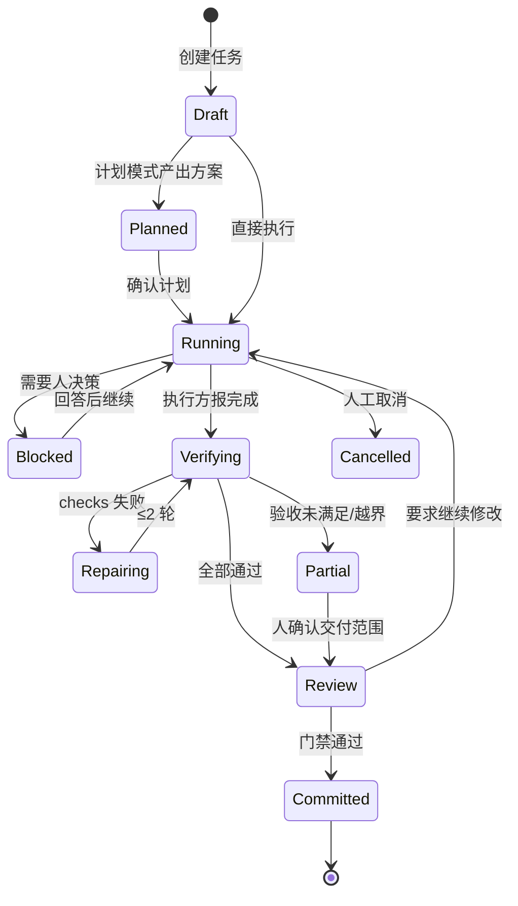
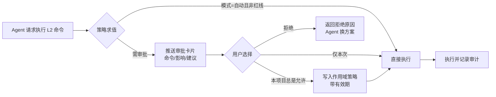

# AgentDesk · 企业智能体工作台 PRD

> 产品代号：AgentDesk
> 文档类型：产品需求文档（PRD）
> 参考对标：ZCode（Agentic Development Environment）+ `zcode-agent` 契约执行模式
> 面向客户：中大型企业研发组织（私有化 / 内网部署）
> 版本：v0.9（评审稿） · 2026-11-13

---

## 0. 文档信息

| 项 | 内容 |
|---|---|
| 产品定位 | 企业内 AI 智能体工作台：以 Agent 为主角完成开发任务，人负责决策、审批与验收 |
| 目标客户 | 50–5000 人研发团队；金融、制造、政企等对代码与数据敏感的行业 |
| 部署形态 | 私有云为主，支持全离线；桌面客户端 + 管理后台 |
| 本期范围 | 单人任务闭环 + 团队治理（不含跨仓大规模编排） |
| 关联文档 | 《AgentDesk 系统设计方案》《AgentDesk 安全合规方案》《AgentDesk 模型网关接入规范》 |

**一句话价值主张**：把"让 AI 写代码"升级为"把任务交出去，拿回经过验证、边界清晰、全程可审计的改动"。

---

## 1. 产品概述

### 1.1 市场与客户问题

| 现状 | 客户原话（典型） | 本质问题 |
|---|---|---|
| 模型能力已够用，但产出不可信 | "它说改好了，我还得自己跑一遍测试" | 缺少**验证闭环** |
| 上下文靠人喂 | "每次都要告诉它用 pnpm、测试跑哪条命令" | 缺少**组织级上下文沉淀** |
| 长任务做不完 | "改到一半断了，前面白干" | 缺少**长任务状态管理** |
| 权限不可控 | "不敢让它碰生产配置" | 缺少**分级授权与红线** |
| 用了但说不清 | "谁在什么时候让 AI 改了什么？" | 缺少**审计与合规证据** |
| 成本不可控 | "一个月 token 花了多少、花在谁身上？" | 缺少**配额与成本归因** |
| 工具割裂 | "IDE、CLI、聊天窗口各一套" | 缺少**统一工作台** |

### 1.2 产品定位

AgentDesk 不是"会写代码的聊天框"，而是 **Agent Development Environment（ADE）**：

```
工作区（仓库/分支/环境）
  └── 任务（一个可检索、可归档、可统计的意图）
        └── 会话（一次 Agent 执行，可中断、可续跑）
              └── 交付（diff + 检查结果 + 验收结论）
```

三条产品原则：

1. **Agent 干活，人做决策**——人只在三个点介入：给目标、批高危动作、验收改动。
2. **没有验证就没有交付**——任务结束必须带检查结果；验证不了的，明确标注"未验证"。
3. **边界先于能力**——先定义能改哪些路径、能跑哪些命令，再谈能不能做。

### 1.3 与参考产品（ZCode）的关系

| 维度 | ZCode（参考） | AgentDesk（本产品） |
|---|---|---|
| 定位 | 面向个人开发者的 ADE | 面向企业研发组织的 ADE + 治理平台 |
| 模型 | GLM-5.3 官方 Harness | 企业模型网关：私有化模型优先，多模型可路由 |
| 身份 | 本地账号 / 订阅 | 企业 SSO、组织架构、项目角色 |
| 权限 | 四档执行模式 | 四档模式 + 组织策略 + 不可绕过红线 + 审批留痕 |
| 生态 | 开放 MCP / Skill / 插件 | 白名单 + 签名 + 内部市场 |
| 审计 | 使用统计 | 全链路审计（人/任务/工具/模型/提交） |
| 协作 | 单机任务 | 任务共享、团队模板、评审、看板 |
| 数据 | 代码在本地 | 代码不出域，索引与向量留在企业域内 |

**结论**：产品骨架与交互范式参考 ZCode（降低用户学习成本、验证过的心智模型），竞争力建立在 **企业治理 + 私有化 + 可验证交付** 三件事上。

### 1.4 差异化壁垒（对客户的价值证明）

1. **可验证交付**：checks + 独立验证会话 + 视觉验收，交付物自带"证据包"。
2. **边界可证明**：会话声明可改路径，越界自动识别并降级，不靠自觉。
3. **合规可举证**：一次任务从提问到提交的全链路可导出，直接应对内审与监管检查。
4. **组织知识复利**：项目规范、踩坑结论、仓库导读沉淀为团队资产，不随人走。

---

## 2. 目标用户

### 2.1 用户画像

| 角色 | 占比 | 核心诉求 | 关键功能 | 成功标准 |
|---|---|---|---|---|
| 一线开发工程师 | 70% | 快、少打断、可回退 | 任务中心、四档模式、Review 逐块接受 | 日常任务 30% 交给 Agent 且愿意复用 |
| 技术负责人 / 架构师 | 15% | 规范统一、风险可控 | 项目指令、审批策略、任务看板 | 团队交付一致，返工率下降 |
| 测试 / QA | 5% | 回归覆盖、缺陷复现 | 检查编排、浏览器验证、缺陷任务模板 | 回归任务自动化率提升 |
| 平台管理员 / IT | 7% | 稳定、成本、可运维 | 模型路由、配额、MCP 白名单、报表 | 故障可定位，成本可解释 |
| 安全 / 合规 | 3% | 可审计、可举证 | 审计检索、导出、密级策略 | 审计一次通过，无需人工补证 |

### 2.2 用户旅程（首次使用，15 分钟内完成第一次成功交付）


**首次体验硬指标**：新用户从登录到第一次 `completed`，中位数 ≤ 15 分钟；不出现"必须先读 30 页文档"的情况。

---

## 3. 核心场景（Jobs to be Done）

| ID | 场景 | 用户目标 | 产品支撑 | 验收信号 |
|---|---|---|---|---|
| S1 | 新功能开发 | 从需求描述到可运行页面 | 任务 + 计划模式 + 前端预览 + 视觉验收 | 页面可打开，验收项全绿 |
| S2 | 存量 Bug 修复 | 用日志/堆栈复现并修好 | 附件/日志引用 + 自动编辑 + 回归检查 | 复现用例通过，无回归 |
| S3 | 跨模块重构 | 一次改十几处不出错 | 计划模式 + 长任务 + 检查点 | 构建通过，越界改动为 0 |
| S4 | 设计稿还原 | 截图变页面 | 图片上下文 + 浏览器点选元素 + 视觉比对 | 关键视口下文案可读、布局一致 |
| S5 | 代码库上手/交接 | 半天读懂陌生仓 | Repo Wiki + 代码索引 + 问答 | 生成架构导读，结论带文件位置 |
| S6 | 团队规范落地 | 新人产出也符合规范 | 项目 `AGENTS.md` 模板 + 提交门禁 | 规范检查项通过率 ≥ 90% |
| S7 | 批量治理（依赖升级/补单测） | 批量但不失控 | 任务模板 + 并行会话 + 路径互斥 | 批量任务成功率 ≥ 70% |
| S8 | 移动端查看与审批 | 不在电脑前也能放行 | 移动端只读 + 审批 + 通知 | 审批平均时长 ≤ 5 分钟 |

### 3.1 场景详细描述（S1：新功能开发）

**前置**：工作区已绑定仓库与分支，项目已有 `AGENTS.md`，模型网关可用。

**主流程**

1. 用户新建任务，填写目标："按设计稿实现套餐页，三档卡片，中间档高亮"，`@` 引用设计稿截图与 `src/pages/pricing`。
2. 选择 **计划模式**，Agent 只读仓库并输出计划：改动文件清单、组件拆分、风险点。
3. 用户确认计划，切换 **自动编辑**。
4. Agent 执行编辑，期间请求执行 `npm run build`（L2，需确认），用户批准"本项目总是允许"。
5. 构建失败，Agent 读报错 → 修复 → 重跑，共 1 轮修复。
6. checks 全绿，进入独立验证：起服务、在 390×844 与 1440×900 截图，判定"三档卡片并排可读/窄屏堆叠可读"。
7. 用户在 Review 面板逐块接受改动，门禁校验通过后提交到功能分支。

**异常分支**

| 异常 | 产品行为 |
|---|---|
| 设计稿缺关键决策（如暗色模式配色） | 不猜；返回 `blocked`，给 2–3 个选项与建议 |
| 用户中途关闭客户端 | 会话保持在服务端运行；重连后事件流续传 |
| 修改了 `owns` 之外的公共组件 | 标记越界，任务降级 `partial`，提交被阻断 |
| 检查连续失败 2 轮 | 停止修复，输出失败摘要与建议，交人处理 |

**验收标准**

- [ ] 从创建到 `completed` 无需人工读代码即可判断是否可提交。
- [ ] 交付包含：diff、checks 结果、视觉截图与结论、越界报告。
- [ ] 任一验收项未满足时，状态不得为 `completed`。

---

## 4. 需求范围

### 4.1 In Scope（本期）

- 桌面客户端（Windows / macOS / Linux）
- 工作区接入：本地目录、SSH 远程、容器
- 任务中心与会话执行、事件流、断点续跑
- 四档执行模式 + 审批 + 红线
- 文件/Shell/Git/浏览器工具；MCP、Skill、Command
- 上下文：项目指令、项目记忆、代码索引、Repo Wiki
- Review 与提交门禁、会话级回滚
- 验证：checks、独立验证会话、视觉验收
- 管理后台：租户、角色、配额、模型策略、MCP 白名单、审计、用量报表
- 移动端：只读查看 + 审批（P1）

### 4.2 Out of Scope（本期不做）

| 不做 | 原因 | 后续 |
|---|---|---|
| 全自动提交主干 | 企业风险不可接受 | 永久不做 |
| 跨仓大规模编排 | 复杂度高、收益未验证 | V2 探索 |
| 自研 IDE 编辑器 | 与 VS Code 生态重复 | 用插件桥接 |
| 需求/项目管理替代 | 边界外 | 通过 API 集成 |
| 第三方 Agent 框架全量接入 | 治理成本高 | V1 起 ACP 适配 |
| 代码托管平台替代 | 边界外 | 对接现有 Git 服务 |

### 4.3 优先级定义

| 级别 | 含义 | 排期 |
|---|---|---|
| P0 | 没有它产品不成立 | MVP 必须交付 |
| P1 | 显著提升留存与口碑 | V1 |
| P2 | 锦上添花 / 特定客户 | V2 或按单 |

---

## 5. 功能需求

> 编号规则：FR-模块-序号。每条含"描述 / 优先级 / 关键交互 / 验收标准"。

### FR-1 工作区接入

| 项 | 内容 |
|---|---|
| 优先级 | P0 |
| 描述 | 用户可绑定本地目录、SSH 主机或本地容器作为工作区；工作区记录仓库、分支、环境类型、所属项目与密级 |
| 关键交互 | 打开工作区时展示"配置审查"页：将要连接的 MCP、将启用的命令、可执行脚本、网络出口；确认后才可创建任务 |
| 验收 | ① 三种接入方式均可创建任务并读写文件；② 陌生仓库首次打开必须经配置审查；③ 工作区可切换分支，切换时提示未提交改动 |

### FR-2 任务中心

| 项 | 内容 |
|---|---|
| 优先级 | P0 |
| 描述 | 任务列表按工作区归类；显示标题、相对时间、状态点（运行中/待确认/失败/完成）、改动行数 `+/-`；支持置顶、分组、归档、搜索 |
| 关键交互 | 顶部固定"新建任务 / 搜索 / 技能"三入口；视图可切"分组 / 工作区 / 时间线"；归档任务支持恢复与删除 |
| 验收 | ① 1000 条任务下列表滚动流畅（≥ 50fps）；② 任务状态变化 1s 内反映到列表；③ 搜索支持标题与任务内容 |

### FR-3 会话与输入增强

| 项 | 内容 |
|---|---|
| 优先级 | P0 |
| 描述 | 输入框支持 `@` 文件/文件夹、`#` 历史会话、`/` 命令、`$` 技能；支持粘贴长文本自动转附件；支持划选回复内容追加为上下文 |
| 关键交互 | `+` 面板聚合四类补充入口；超长粘贴转附件并保留全文；划选引用有长度与条数上限，超限明确提示不静默截断 |
| 验收 | ① 四类符号均可正确解析并体现在上下文；② 引用超限有提示且不丢已有草稿；③ 单次任务可引用 ≥ 20 个文件 |

### FR-4 执行模式与权限审批

| 项 | 内容 |
|---|---|
| 优先级 | P0 |
| 描述 | 四档模式：变更前确认（默认）、自动编辑、计划模式、完全访问；红线规则任何模式不可绕过；审批支持"仅本次 / 本项目总是允许 / 拒绝"，"总是允许"带作用域与有效期 |
| 关键交互 | 输入框处可切换模式（快捷键循环）；高危动作弹审批卡片，展示命令原文、影响范围、建议；审批结果写入审计 |
| 验收 | ① 四档模式下工具行为符合权限矩阵；② 红线动作 100% 拦截，包括"总是允许"路径；③ 审批记录可按人/时间/任务检索；④ 审批平均 3 次点击内完成 |

**红线清单（产品级硬约束）**

- 删除根目录/磁盘格式化/清空数据库类命令
- 读取或外传密钥、凭据、生产配置
- 强制推送、改写主干历史
- 直连生产库执行 DDL/DML
- 下载并执行非白名单脚本
- 修改审计与权限模块自身

### FR-5 Agent 执行与长任务

| 项 | 内容 |
|---|---|
| 优先级 | P0（续跑为 P1） |
| 描述 | 任务以"目标 + 子目标 + 验收项"结构执行；每轮工具调用实时推送事件；支持检查点写入、中断续跑、停滞检测 |
| 关键交互 | 事件流展示思考摘要、工具调用、命令输出、检查结果；`blocked` 时以卡片形式给出问题、选项、建议，一次回复即可续跑；停滞超阈值提示"可能卡住"，不自动重试 |
| 验收 | ① 客户端断网 5 分钟后重连，历史事件不丢；② 进程被杀后可从未超 5 分钟的检查点恢复；③ 停滞 8 分钟标记并通知；④ 单任务支持 ≥ 2 小时连续执行 |

### FR-6 工具与扩展生态

| 项 | 内容 |
|---|---|
| 优先级 | P0（MCP/Skill）/ P1（插件市场） |
| 描述 | 内置文件、Shell、Git、浏览器自动化工具；支持 MCP（stdio/HTTP/SSE，用户级与工作区级双作用域）、Skill（Markdown）、Command（模板）；插件打包分发 |
| 关键交互 | MCP 设置页分组展示"已配置 / 插件自带"，支持表单与 JSON 两种录入、OAuth 授权、从外部 Agent 配置一键导入；工作区配置需管理员签名才自动连接 |
| 验收 | ① 双作用域配置优先级符合规则且不互相污染；② OAuth 服务授权失败只影响该服务，不阻断会话；③ 未签名的工作区 MCP 不自动连接，仅提示 |

### FR-7 上下文与知识沉淀

| 项 | 内容 |
|---|---|
| 优先级 | P0（项目指令）/ P1（记忆、Wiki） |
| 描述 | 读取平台指令、用户全局偏好、项目 `AGENTS.md`；项目记忆在任务成功后自动提炼可复用事实；代码索引支持符号与语义检索；Repo Wiki 生成架构导读（结论带文件位置） |
| 关键交互 | 设置页可开关项目记忆（默认关，开启提示 token 成本）；Wiki 支持重新生成与增量更新；记忆可查看、可删除（V1） |
| 验收 | ① 项目指令注入顺序为平台→用户→项目，冲突以项目为准；② 记忆不写入密钥/一次性细节；③ Wiki 每条结论可点击跳转到源码位置；④ 索引增量更新延迟 ≤ 1 分钟 |

### FR-8 Review 与交付

| 项 | 内容 |
|---|---|
| 优先级 | P0 |
| 描述 | 按文件聚合 diff，逐块接受/拒绝；标注改动来源（回合/工具）；内嵌检查与验收结论；提交前门禁；会话级回滚 |
| 关键交互 | 未接受的改动保留在工作区但不进提交；门禁失败给出具体原因与跳转；回滚以会话为单位，避免半成品残留 |
| 验收 | ① 逐块接受后提交内容与接受结果一致；② 门禁未通过时无法提交（可强制但需二次确认并留痕）；③ 回滚后工作区与任务开始前一致（除显式保留项） |

### FR-9 验证体系

| 项 | 内容 |
|---|---|
| 优先级 | P0 |
| 描述 | 三层验证：自检（构建/测试/lint）、独立验证会话（不看实现过程，按视口截图判定）、人工 Review |
| 关键交互 | 检查失败自动回灌修复（默认 ≤ 2 轮）；验证结论逐条展示"满足/未满足/无法判定"；截图可放大对比 |
| 验收 | ① 验证器无法判定时输出 `met: null` 而非猜测；② 每轮验证保留截图与判定理由；③ 无 checks 的任务必须标注"未验证" |

### FR-10 模型与推理强度

| 项 | 内容 |
|---|---|
| 优先级 | P0 |
| 描述 | 支持多模型选择与按任务路由；推理强度分 low/high/max；模型切换保持会话上下文 |
| 关键交互 | 输入框旁展示当前模型与强度；管理员可配"默认模型 / 高密级仓库禁用外部模型" |
| 验收 | ① 切换模型不丢上下文；② 高密级仓库强制走私有化模型，绕过尝试被拦截；③ 每次请求记录模型、token、成本 |

### FR-11 团队协作

| 项 | 内容 |
|---|---|
| 优先级 | P1 |
| 描述 | 任务可共享给同项目成员；支持任务模板（Bug 修复/新页面/重构）；团队规范模板库；任务看板按项目/人聚合 |
| 关键交互 | 共享任务只读/可续跑两种权限；模板可带预置 checks 与验收项 |
| 验收 | ① 共享任务的操作全部留痕；② 模板创建任务时自动带入 checks；③ 看板可按项目、状态、人筛选 |

### FR-12 管理与治理

| 项 | 内容 |
|---|---|
| 优先级 | P0（审计/配额）/ P1（报表） |
| 描述 | 租户与项目管理、角色权限（开发者/负责人/管理员/审计员）、模型与工具策略、配额（人/项目/日）、MCP 与插件白名单、审计检索与导出、用量与成本报表 |
| 关键交互 | 管理后台独立入口；策略变更需二次确认并记录变更人；审计支持按人/任务/工具/时间四维组合查询，导出 CSV/PDF |
| 验收 | ① 策略变更 1 分钟内对新会话生效；② 配额耗尽时给出明确提示与申请入口；③ 审计导出包含完整证据链（谁、何时、何工具、何参数、何结果）；④ 审计留存 ≥ 180 天 |

### FR-13 移动端（P1）

| 项 | 内容 |
|---|---|
| 描述 | 查看任务进度、接收审批通知、批准/拒绝高危动作、查看交付摘要与截图 |
| 验收 | ① 审批可在 2 次点击内完成；② 与桌面端状态实时一致（延迟 ≤ 3s）；③ 不支持在移动端改代码 |

---

## 6. 关键流程图

### 6.1 任务主流程与状态



### 6.2 审批交互



---

## 7. 非功能需求

| 类别 | 指标 | 优先级 |
|---|---|---|
| 性能 | 首 token 延迟 P95 ≤ 3s；事件推送延迟 ≤ 500ms；沙箱冷启动 ≤ 20s；1000 文件仓库索引 ≤ 60s | P0 |
| 容量 | 单集群支持 500 并发会话；单仓支持 10 万文件；单任务上下文 1M token 稳定 | P0 |
| 可用性 | 核心链路 99.5%；会话进程异常不丢检查点；模型网关降级可切换备用模型 | P0 |
| 安全 | 代码不出域（可配置）；密钥不入上下文；高危命令拦截率 100%；越权访问 0 容忍 | P0 |
| 合规 | 审计留存 ≥ 180 天；支持等保/内审证据导出；数据分级与密级策略 | P0 |
| 兼容 | Windows 10+/macOS 12+/主流 Linux；Git 2.30+；Node 18+（部分工具链） | P0 |
| 离线 | 全离线模式可用（私有化模型 + 本地索引 + 禁网工具） | P1 |
| 可观测 | 每任务可查完整 trace；成本按人/项目/模型归因 | P1 |
| 国际化 | 中英双语 UI；代码与文档不强制语言 | P2 |

---

## 8. 数据与指标

### 8.1 北极星指标

**每周"已验证交付任务数"（Verified Deliveries per Week，按活跃开发者归一）**

选择理由：它同时约束"用起来"（数量）、"交付可信"（已验证）、"可持续"（人均），避免用"调用次数"这种虚荣指标。

### 8.2 指标树

| 层级 | 指标 | 口径 | 目标（上线 3 个月） |
|---|---|---|---|
| 北极星 | 人均周验证交付数 | `completed` 任务 / 周活开发者 | ≥ 3 |
| 规模 | 周活开发者、任务创建数 | 去重账号 | 覆盖目标团队 60% |
| 质量 | 已验证完成率 | `completed` / 全部任务 | ≥ 65% |
| 质量 | 一次通过率 | 零修复即完成 | ≥ 45% |
| 质量 | 越界改动率 | 触发越界任务占比 | ≤ 3% |
| 效率 | 人工接管率 | `blocked` 或人工收尾 | ≤ 25% |
| 效率 | 任务平均墙钟 | 创建到完成 | ≤ 25 分钟（中小任务） |
| 体验 | 首次成功交付时长 | 新用户首任务 | ≤ 15 分钟 |
| 成本 | 单任务成本 | 网关计量 | 环比降 20% |
| 留存 | 4 周留存 | 周活口径 | ≥ 50% |
| 风险 | 提交后 7 天 revert 率 | Git 统计 | ≤ 5% |

### 8.3 关键埋点

| 事件 | 关键属性 |
|---|---|
| `task_created` | 来源（模板/自由）、模式、引用文件数 |
| `mode_switched` | 从/到、切换时点 |
| `approval_shown` / `approval_decided` | 工具、风险级、决策、耗时 |
| `check_finished` | 命令、轮次、结果、耗时 |
| `verify_finished` | 验收项数、满足数、无法判定数 |
| `hunk_accepted` / `hunk_rejected` | 文件类型、行数 |
| `task_finished` | 状态、修复轮次、时长、成本 |
| `memory_used` | 命中条数、来源 |

---

## 9. 版本规划

| 版本 | 时间 | 范围 | 出口标准 |
|---|---|---|---|
| **MVP** | 6–8 周 | FR-1/2/3/4/5(基础)/6(内置工具)/8/9(checks)/10；单机与单仓；管理员基础配置 | 10 个真实任务端到端跑通；已验证完成率 ≥ 50%；无红线绕过 |
| **V1** | +3 个月 | 沙箱隔离与并行、项目记忆、Repo Wiki、独立视觉验证、MCP 双作用域与白名单、审计与成本报表、团队模板、移动审批 | 20 人团队日常使用；越界率 < 5%；审计可导出；成本可归因 |
| **V2** | +6 个月 | 长任务续跑与目标模式、Plan DAG 并行编排、ACP 多框架接入、插件市场、跨仓编排试点、离线模式 | 2 小时以上长任务成功率 ≥ 60%；中断恢复可用；多框架可切换 |

---

## 10. 依赖与风险

### 10.1 外部依赖

| 依赖 | 影响 | 应对 |
|---|---|---|
| 私有化模型能力 | 长任务稳定性直接决定体验 | 双模型备份 + 能力基线评测后再放量 |
| 企业 SSO / 组织架构 | 权限与审计的基础 | MVP 阶段先支持本地账号，V1 接 SSO |
| 代码托管与 CI | 提交与检查依赖 | 提供适配层，优先支持主流 Git 与 Jenkins/GitLab CI |
| 沙箱基础设施（K8s） | 隔离与并发 | MVP 允许本地容器，V1 上集群 |

### 10.2 产品风险

| 风险 | 表现 | 缓解 |
|---|---|---|
| 用户不信任 | 只看不用、只当搜索 | 首任务设计成"低风险高成功率"；交付带证据包 |
| 验证形式化 | checks 形同虚设 | 强制"无验证即标注"，把未验证率纳入团队看板 |
| 权限过严导致弃用 | 每步都要批 | 默认策略按风险分级；允许项目级"总是允许"并带有效期 |
| 成本失控 | 大户挤占配额 | 配额 + 路由 + 压缩；按项目核算并公示 |
| 组织阻力 | "AI 写的代码不敢要" | 试点团队 + 双人评审 + revert 率公开 |

### 10.3 开放问题（需业务方决策）

1. 高密级仓库是否允许"仅本地模型 + 完全禁网"？（影响验证器与联网检索可用性）
2. 提交是否必须经平台（而非开发者本地提交）以换取完整审计？
3. 项目记忆默认个人可见还是团队共享？
4. 审批策略由平台统管还是允许项目覆盖？覆盖上限是什么？
5. 移动端是否允许"批准 + 让 Agent 继续"，还是只读？

---

## 11. 需求总表（评审用）

| ID | 需求 | 优先级 | 版本 | 负责模块 |
|---|---|---|---|---|
| FR-1 | 工作区接入与配置审查 | P0 | MVP | 客户端 / 平台 |
| FR-2 | 任务中心 | P0 | MVP | 客户端 |
| FR-3 | 输入增强（@ # / $） | P0 | MVP | 客户端 / 上下文 |
| FR-4 | 执行模式、审批与红线 | P0 | MVP | 权限 |
| FR-5 | 执行与长任务（续跑 P1） | P0/P1 | MVP/V2 | Agent Runtime |
| FR-6 | 工具与扩展（MCP/Skill） | P0 | MVP | 工具层 |
| FR-7 | 上下文与知识（记忆/Wiki P1） | P0/P1 | MVP/V1 | 上下文 |
| FR-8 | Review 与交付门禁 | P0 | MVP | 客户端 / 交付 |
| FR-9 | 验证体系 | P0 | MVP | 验证器 |
| FR-10 | 模型路由与推理强度 | P0 | MVP | 模型网关 |
| FR-11 | 团队协作 | P1 | V1 | 平台 |
| FR-12 | 管理治理（审计/配额） | P0/P1 | MVP/V1 | 管理后台 |
| FR-13 | 移动端 | P1 | V1 | 移动端 |

---

## 附录 A：术语表

| 术语 | 含义 |
|---|---|
| ADE | Agentic Development Environment，以 Agent 为主角的开发环境 |
| 任务契约 | 结构化任务描述：目标、决策、约束、验收、检查、可改路径 |
| `owns` | 会话允许改动的路径集合，用于并行互斥与越界检测 |
| Hunk | diff 中的连续改动块，Review 的最小接受单元 |
| 检查点 | 长任务执行过程中的状态快照，用于中断后续跑 |
| 独立验证 | 不看实现过程的新会话，只看运行结果与截图做判定 |
| 红线 | 任何模式、任何授权都不可执行的动作集合 |

## 附录 B：与竞品的取舍说明

| 能力 | 通用 AI IDE（如 Cursor 类） | CLI Agent（如 Claude Code 类） | ZCode | AgentDesk |
|---|---|---|---|---|
| 形态 | 编辑器内 | 终端内 | 桌面 ADE | 桌面 ADE + 管理后台 |
| 企业身份与权限 | 弱 | 无 | 无 | 强 |
| 审计与合规 | 弱 | 无 | 弱 | 强 |
| 私有化模型 | 部分 | 部分 | 以官方模型为主 | 支持 |
| 验证与交付门禁 | 中 | 弱 | 中 | 强 |
| 团队知识沉淀 | 弱 | 弱 | 中 | 强 |
| 上手成本 | 低 | 中 | 低 | 中（有治理配置） |

**结论**：不与通用 IDE 争"编辑体验"，不与 CLI 争"极客轻量"；用 **治理 + 验证 + 私有化** 切企业市场。
